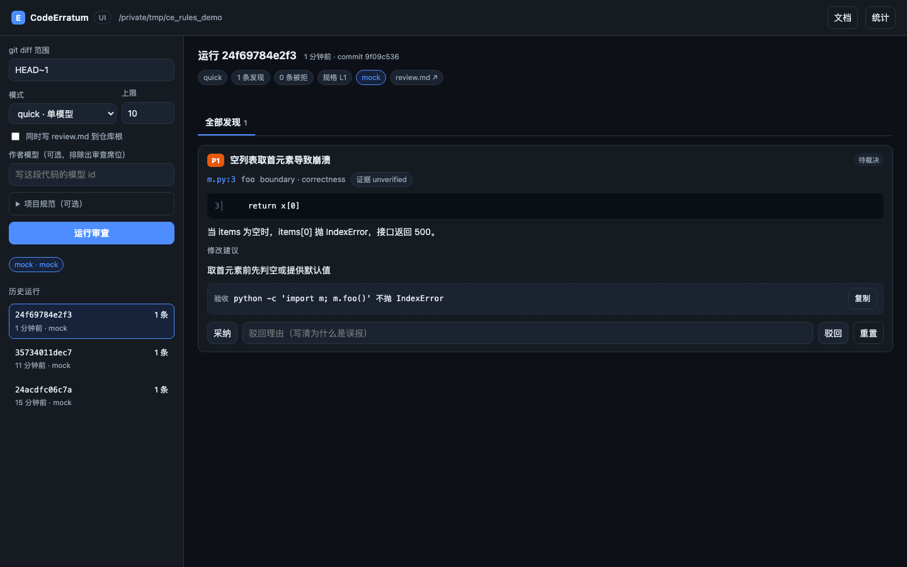
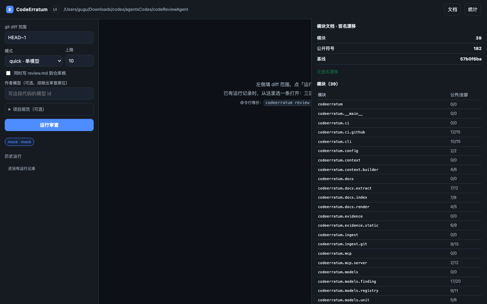

# CodeErratum

**English** | [简体中文](README.zh-CN.md)

[](https://github.com/a2012s/CodeErratum/actions/workflows/ci.yml)
[](LICENSE)
[](pyproject.toml)

**An errata sheet for code written by AI.**

CodeErratum reads a git diff and writes a `review.md` — not a list of comments for humans to skim, but a **work order another coding agent can execute directly**: exact location, expected behavior, a concrete fix, and an acceptance command.

> Formerly known as `reviewCodeAgent` / `CrossCheck` / `Erratum`. The name was checked against the PyPI, npm and GitHub registries — none taken. Fallback name: `Snag`.

## The one goal (phase 1)

> Hand `review.md` to Claude Code / Cursor / Cline as-is, and it fixes the code without asking a single follow-up question.

Success criterion: sample 10 findings at random; at least 7 must be executed correctly by a downstream agent with no clarification.

## Status

- **Phases 1–6 implemented and tested** (170 tests + real-HTTP end-to-end + CI)
- Commands: `review` (write the work order) / `pr` (post to a pull request) / `docs` (module map + signature drift) / `mcp` (stdio server for coding agents) / `ui` (local web UI) / `accept` / `reject` / `stats` / `compare`
- Written in Python ≥3.11; symbol-level review for Python, file-level for everything else; any OpenAI-compatible provider (cloud or local); `correctness` lens
- Three review modes: `quick` (single model) / `dual` (two models + falsification) / `committee` (three models)
- No Docker. Three environment variables get a single model running — including a local Ollama endpoint; multi-model uses one JSON config

## Install

```bash
git clone git@github.com:a2012s/CodeErratum.git
cd CodeErratum
uv sync --extra dev
uv run codeerratum --version
```

Without uv, the equivalent:

```bash
python3.11 -m venv .venv && .venv/bin/pip install -e ".[dev]"
.venv/bin/codeerratum --version
```

> Not on PyPI yet — `pip install codeerratum` will not work today. After `uv sync` the command lives in `.venv/bin/`.

## Configuration

The CLI does **not** load `.env` on its own; export the variables into your shell:

```bash
cp .env.example .env && vi .env     # fill in BASE_URL / API_KEY / MODEL
set -a && source .env && set +a
```

A single model needs three variables. Heterogeneous multi-model uses `CODEERRATUM_MODELS` (JSON) plus `CODEERRATUM_MODE` — see below.

## Usage

Run it **inside the repository under review**, not inside this project's directory:

```bash
cd /path/to/your-repo
codeerratum review --diff HEAD~1 -o review.md
```

`--diff` takes any git revspec: `HEAD~1`, `HEAD~3..HEAD`, `main...feature`, a raw commit sha. For local uncommitted work use `--diff HEAD` (staged and unstaged together); brand-new files must be `git add`-ed first, but never committed. Add `--path src/api` to review only that folder's changes (no `git add` needed for tracked files). At most 10 review units per run by default (`--max-units` to change it) — a hard cost gate, not a suggestion. The `review.md` lands in the root of the reviewed repo; trace artifacts go to `.codeerratum/runs/<run_id>/`.

> Reviewing a revision that is **not checked out** (e.g. `main...feature`): sources, excerpts and anchor checks all read the diff revision's git blob, so no checkout is needed. Only files whose blob is unavailable (e.g. uncommitted working-tree edits) fall back to the working tree; a mismatch there skips the file and is listed in the run's coverage notes.

## Zero-cost self-check

```bash
uv run pytest -q                     # expect 170 passed
```

To exercise the whole pipeline without spending tokens, use the bundled fake model endpoint (always returns one fixed finding):

```bash
uv run python scripts/mock_server.py          # terminal A, listens on 127.0.0.1:8899

# terminal B, inside any repo with at least 2 commits
CODEERRATUM_BASE_URL=http://127.0.0.1:8899/v1 CODEERRATUM_API_KEY=x \
CODEERRATUM_MODEL=mock codeerratum review --diff HEAD~1 -o review.md
```

## Quick start

With three environment variables set, it is one command:

```bash
export CODEERRATUM_BASE_URL=https://api.example.com/v1
export CODEERRATUM_API_KEY=sk-...          # may be empty for local endpoints
export CODEERRATUM_MODEL=your-model-id
codeerratum review --diff HEAD~1 -o review.md
```

Two heterogeneous models (dual — the core of phase 3). At least two different vendors, plus an optional third to act as falsifier:

```bash
export CODEERRATUM_MODELS='[
  {"model_id":"gpt-4o-2024-08-06","base_url":"https://api.openai.com/v1","api_key":"sk-...","family":"openai"},
  {"model_id":"claude-3-5-sonnet","base_url":"https://api.anthropic.com/v1","api_key":"sk-...","family":"anthropic"},
  {"model_id":"deepseek-chat","base_url":"https://api.deepseek.com/v1","api_key":"sk-...","family":"deepseek"}
]'
export CODEERRATUM_MODE=dual
codeerratum review --diff HEAD~1 -o review.md
```

`family` is the heterogeneity test: two model IDs from the same vendor do not count as heterogeneous and the router will reject them. The falsification round prefers the third vendor; without one, the two reviewers falsify each other's findings. If a model wrote the code, pass `--author-model <model_id>` to keep it out of the reviewer seats (design invariant #1).

Hand the resulting `review.md` to Claude Code / Cursor / Cline. Every run leaves traceable artifacts in `.codeerratum/runs/<run_id>/` (`input.diff`, `units.json`, `calls.json`, `findings.json`, `static_diags.json`); the feedback database sits in the same directory and never pollutes your working tree.

A real artifact, without spending a token, is in [`examples/sample-review.md`](examples/sample-review.md) — the format is genuine, the content comes from the bundled fake endpoint.

In dual mode the report splits into three sections: **unique findings** (reported by only one model — the most valuable part) / **conflicts** (models disagree, awaiting a human call) / **consensus**.

### Project rules (optional)

Tell the reviewer what this project has already decided, so it stops flagging settled questions:

```bash
codeerratum review --diff HEAD~1 --rules project-rules.md
# or drop the flag entirely — .codeerratum/rules.md is discovered automatically
```

```markdown
<!-- .codeerratum/rules.md -->
- No type hints in this repo; missing annotations are not a finding.
- The f-string cost in the logger is a deliberate trade-off; do not report it.
```

Rules are **appended, never substituted**. They land in a `<house_rules>` block between the hard rules and the output contract, and the prompt states that a project rule loses to a hard rule on conflict. That ordering is not cosmetic: a substituted system prompt lets a rule ask for longer `claim` values or non-verbatim snippets, and the anchor check would then discard every finding — producing a clean, empty report that reads exactly like "no bugs found".

The cap is 4000 characters; anything longer is truncated and the truncation is stated in the report. The rules actually used are recorded as a 12-char sha256 in both `review.md` and `findings.json`, so when two runs over the same diff disagree you can tell whether the prompt changed. The falsification round deliberately does **not** receive project rules — a falsifier that has absorbed your conventions stops being an independent check.

Feedback after a review: `codeerratum accept <finding_id>`, `codeerratum reject <finding_id> --reason "..."`, `codeerratum stats` for the acceptance rate, `codeerratum compare` for per-model unique-finding counts and measured profiles. All three resolve to the same database from any subdirectory of the repo.

## Web UI (optional)

```bash
codeerratum ui                      # serves http://127.0.0.1:8765/ and opens a tab
codeerratum ui --port 9000 --no-browser
```



The docs drawer is the same server, one click away — module map and signature drift without a build step:



Standard library only — no FastAPI, no bundler, no `node_modules`. The install story stays "three environment variables and you're done", and the UI adds what a terminal can't show: the three zones side by side, evidence strength per finding, the falsification trail, and accept/reject buttons that write straight into `feedback.db`.

Pick the diff range, path filter, mode, unit cap and author model in the left panel; the run history below it reopens any past run. It binds loopback only, rejects non-loopback Hosts (DNS rebinding), and requires a same-origin `Origin` on every POST, so a random web page cannot trigger a paid review through your browser.

The header's **Switch repo** button points the running UI at any local git repository — paste an absolute path (`~` works), or pick one of the six recent repos kept in browser storage. A subdirectory snaps up to the git root; each repo reads its own `.codeerratum/config.json`, so saved model settings follow the target. Switching is refused while a review runs (artifacts are keyed to the repo path), and browsers cannot read a native folder picker — hence paste, not a directory dialog.

The header's **Config** button shows the active mode and model endpoints and lets you edit them. Saving writes `.codeerratum/config.json` (mode 0600), which takes precedence over environment variables and survives a restart — the CLI reads the same file. API keys are never echoed to the browser; leave the key field blank to keep the stored value.

### Posting to a pull request

```bash
codeerratum pr                        # dry run: prints exactly what would be posted
GITHUB_TOKEN=... codeerratum pr --post
```

Inline comments cap at five, each on a line that is genuinely part of the diff. GitHub
rejects the *entire* review when one comment points outside it, so a finding that cannot be
placed goes into the summary table instead of taking the other four down with it. Re-running
on the same commit does not repost — the summary carries a hidden marker and the poster
checks before writing.

In Actions, use the bundled [`action.yml`](action.yml); the example workflow is
[`docs/github-action.yml`](docs/github-action.yml). Two things bite here: `fetch-depth: 0`
is required (a shallow clone cannot see the merge base), and fork PRs have no secrets — the
sample skips them explicitly rather than failing red on every outside contribution.

### Module docs and signature drift

```bash
codeerratum docs                   # docs/api/*.md + .codeerratum/docs-index.json
codeerratum docs --check --strict  # CI gate: exit 1 when a public signature changed
```

Generated from the AST, not by a model, so the docs cannot drift on their own. Drift means
"the public API shape changed": line numbers are recorded for navigation but never compared,
because a check that fires on every refactor is a check nobody keeps switched on.

### MCP server

```bash
codeerratum mcp --repo /path/to/repo
```

JSON-RPC over stdio, four tools: `review_diff`, `list_runs`, `get_finding`,
`check_docs_drift`. Register it as a stdio server and the agent can review its own output
before handing it back — no shell round-trip, no copy-paste:

```json
{
  "mcpServers": {
    "codeerratum": {
      "command": "codeerratum",
      "args": ["mcp", "--repo", "/absolute/path/to/repo"]
    }
  }
}
```

### Local models

Any OpenAI-compatible endpoint works, and no API key is required:

```bash
export CODEERRATUM_BASE_URL=http://localhost:11434/v1   # Ollama
export CODEERRATUM_MODEL=qwen2.5-coder:14b
codeerratum review --diff HEAD~1
```

## Design invariants

1. **The reviewer is never the author** — a model that generated the code may not sit on the review panel
2. **Every finding carries a location** — if file, line and quoted snippet don't line up, the finding is dropped
3. **Output is a work order, not a comment** — expected behavior, concrete fix, acceptance criterion; all three or it doesn't ship
4. **AI review passing ≠ mergeable** — the report always keeps a human-confirmation slot
5. **Truth is not decided by majority vote** — LLM errors are highly correlated; a cross-vendor *falsification* round replaces voting, and unique findings get their own section

## Roadmap (in priority order)

| Phase | Theme | Status |
|---|---|---|
| 1 | Executable work order: diff → a `review.md` an AI can follow | ✅ Done |
| 2 | Trust: eliminate hallucinated locations and vacuous claims | ✅ Done |
| 3 | Heterogeneous cross-check: two models + falsification, surfacing unique findings | ✅ Done |
| 4 | Automation: GitHub Action, PR comments, rule library | ✅ Done |
| 5 | Doc generation: module map + signature drift | ✅ Done |
| 6 | Extensions: MCP server, local models, language tags — **sandbox reproduction deliberately not built** | ✅ Done (partial by design) |
| UI | Local web UI: three-zone report, in-place verdicts, docs drawer | ✅ Done |

Sandbox reproduction was the one feature I refused to add: it means executing untrusted
code from a pull request inside an unauthenticated local service. The risk/benefit is
not close, and "we run your code to prove the bug" is a promise a side project cannot
keep safely.

Full scope and acceptance criteria: [开发计划.md](开发计划.md) (Chinese).

## About the docs

Internal product design, competitive and cost analysis, and architecture details are **not published with this repo**; they stay in a private local directory. This repo ships only the README, the development plan, examples and user docs.

## License

[MIT](LICENSE) © 2026 a2012s. Commercial use, modification and closed-source redistribution are all permitted; keep the copyright and license notice. The license does not cover your model provider's terms of service, and it warrants nothing about the correctness of the review output.
