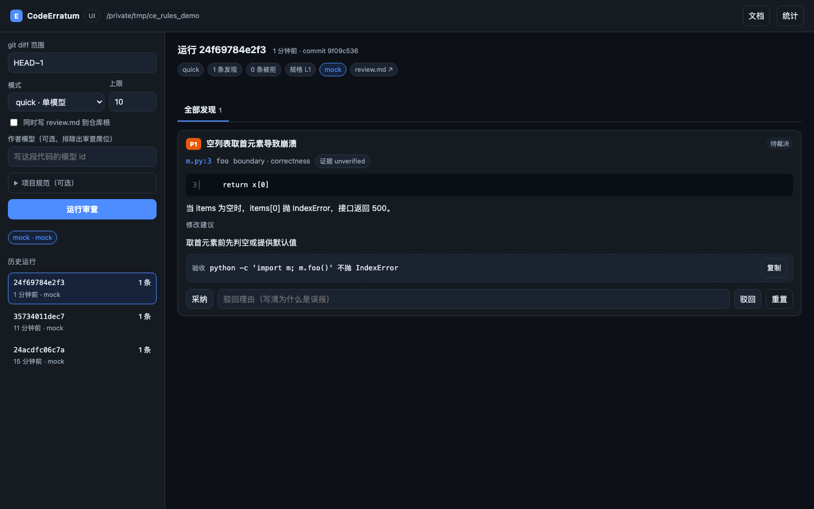
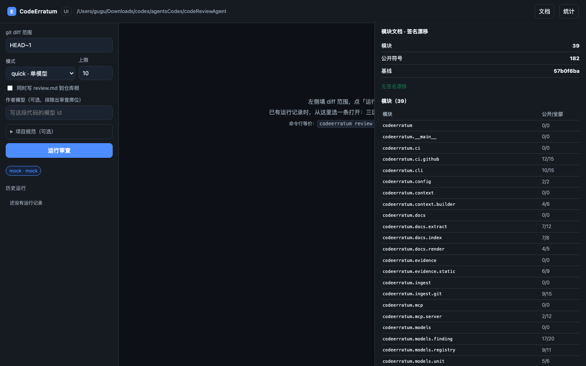

# CodeErratum

[English](README.md) | **简体中文**

[](https://github.com/a2012s/CodeErratum/actions/workflows/ci.yml)
[](LICENSE)
[](pyproject.toml)

**给 AI 写的代码开一张勘误表。**

`CodeErratum` 读一次 git diff，输出一份 `erratumReview.md` —— 不是给人看的评论列表，而是**给另一个写代码的 AI 直接执行的修改工单**：精确定位、说明期望行为、给出改法和验收命令。

> 项目早期代号 `reviewCodeAgent` / `CrossCheck` / `Erratum`。名称已在 PyPI、npm、GitHub 完成注册表级查重，均无占用；备选名 `Snag`。

## 第一期目标（唯一）

> 把 `erratumReview.md` 原样交给 Claude Code / Cursor / Cline，它能在不追问的情况下改对代码。

判据：随机抽 10 条 finding，下游 AI 直接执行成功的比例 ≥ 7 条。

## 当前状态

- **第一至六期已实现并通过测试**（完整回归套件 + 真实 HTTP 端到端验证 + CI）
- 可用命令：`review`（出工单）/ `pr`（贴到 PR）/ `docs`（模块文档与签名漂移）/ `mcp`（给 agent 用的 stdio 服务）/ `ui`（本地图形界面）/ `accept` / `reject` / `reconcile`（回收执行结果）/ `stats` / `compare`
- 实现语言 Python ≥3.11；Python 走符号级审查，其他语言走文件级；OpenAI 兼容 provider（云端或本地）；correctness 视角
- 三种审查模式：`quick`（单模型）/ `dual`（双模型+证伪）/ `committee`（三模型）
- 不依赖 Docker；单模型三环境变量即可跑通（含本地 Ollama），多模型用 JSON 配置

## 安装

```bash
git clone git@github.com:a2012s/CodeErratum.git
cd CodeErratum
uv sync --extra dev
uv run codeerratum --version
```

不想用 uv 时等价做法：

```bash
python3.11 -m venv .venv && .venv/bin/pip install -e ".[dev]"
.venv/bin/codeerratum --version
```

> PyPI 尚未发布，`pip install codeerratum` 现在不可用；装完 `uv sync` 后 `codeerratum` 就在 `.venv/bin/` 里。
>
> 想要桌面窗口，把 `.[desktop]` 一起装上：`uv sync --extra dev --extra desktop`（只多一个 `pywebview`，不装 Chromium）。

## 配置

CLI **不会**自动读 `.env`，必须导出为环境变量：

```bash
cp .env.example .env && vi .env     # 填 BASE_URL / API_KEY / MODEL
set -a && source .env && set +a
```

单模型只需三个变量；异构多模型用 `CODEERRATUM_MODELS`（JSON）+ `CODEERRATUM_MODE`，见下文。

## 运行

在**被审查的仓库**里执行（不是在本项目目录里）：

```bash
cd /path/to/your-repo
codeerratum review --diff HEAD~1 -o erratumReview.md
```

`--diff` 收任意 git revspec：`HEAD~1`、`HEAD~3..HEAD`、`main...feature`、某个 commit sha。审本地未提交的改动用 `--diff HEAD`（暂存与未暂存一起）；全新文件要先 `git add`（不必 commit）。目录里还没有任何提交（刚 `git init`，或整份代码是拷进来的）时，`HEAD` 不存在，把空树 `4b825dc642cb6eb9a060e54bf8d69288fbee4904` 当 `--diff`，全部已暂存文件都会作为新增进入审查——一次会切出几百个单元，按目录用 `--path` 分批更实际。加 `--path src/api` 可只审该目录的改动，已跟踪文件不需要先 `git add`。默认自动决定审多少单元（`AUTO_UNIT_BUDGET=60`；`--max-units 0` 审全部，正数照用，上限 500）。产物 `erratumReview.md` 在原仓库根目录，溯源文件落在 `.codeerratum/runs/<run_id>/`。

> 审 `main...feature` 这类**未 checkout 的版本**时，源码、摘录与锚点校验都直接取 diff 版本的 git blob，不需要先切分支。只有当某个文件的 blob 取不到（例如未提交的工作区改动）时才回退到工作区，内容对不上会跳过该文件并在「本次覆盖说明」写明。

## 不花钱的自检

```bash
uv run pytest -q                     # 期望全量测试通过
```

想验证全链路又不想消耗 token，用仓库自带的假模型端点（固定返回一条 finding）：

```bash
uv run python scripts/mock_server.py          # 终端 A，监听 127.0.0.1:8899

# 终端 B，在任意有 ≥2 次提交的仓库里
CODEERRATUM_BASE_URL=http://127.0.0.1:8899/v1 CODEERRATUM_API_KEY=x \
CODEERRATUM_MODEL=mock codeerratum review --diff HEAD~1 -o erratumReview.md
```

## 快速开始

配好三个环境变量后，一条命令：

```bash
export CODEERRATUM_BASE_URL=https://api.example.com/v1
export CODEERRATUM_API_KEY=sk-...          # 本地端点可留空
export CODEERRATUM_MODEL=your-model-id
codeerratum review --diff HEAD~1 -o erratumReview.md
```

双模型异构交叉（dual，第三期核心价值）：至少配 2 个不同 `model_id` + 可选第 3 个作证伪（committee 需 3 个）。同一厂商的不同版本也算两个独立评审者。

```bash
export CODEERRATUM_MODELS='[
  {"model_id":"gpt-4o-2024-08-06","base_url":"https://api.openai.com/v1","api_key":"sk-...","family":"openai"},
  {"model_id":"claude-3-5-sonnet","base_url":"https://api.anthropic.com/v1","api_key":"sk-...","family":"anthropic"},
  {"model_id":"deepseek-chat","base_url":"https://api.deepseek.com/v1","api_key":"sk-...","family":"deepseek"}
]'
export CODEERRATUM_MODE=dual
codeerratum review --diff HEAD~1 -o erratumReview.md
```

异构判据是锁定版本的 `model_id`：`qwen3.8-flash` 与 `qwen4-max-preview` 算两个独立评审者（版本侧重点不同）。相同 `model_id` 重复配置会被拒绝。`family` 仅是展示/报告标签，留空按 model_id 前缀推断，不影响能否同席。证伪轮优先用未参与审查的空闲模型；没有空闲模型时，在评审者之间交叉证伪（发现由谁提出，就换另一个没提过的模型来推翻）。
如果这段代码是某个模型写的，用 `--author-model <model_id>` 把它排除出审查席位（设计底线第 1 条）。

超时按「连接」和「读取」分开算：连接 10s（端点挂死就别等了），读取默认 240s，可用 `CODEERRATUM_READ_TIMEOUT` 调（推理型模型建议 420）。240s 不是拍的——生成上限 8192 token、实测约 50 token/s，满长度需要 ~165s，过去统一 120s 等于把长答案掐死。读取超时只重试 1 次：对端已经安静了一整窗，再等一整窗通常只是多花时间与输入费用；429/5xx 与连接错误重试 3 次，并且在对方给了 `Retry-After` 时按它退避（上限 30s）。

产出 `erratumReview.md` 交给 Claude Code / Cursor / Cline 执行；每次运行的可追溯产物落在 `.codeerratum/runs/<run_id>/`（`input.diff` / `units.json` / `calls.json` / `findings.json` / `static_diags.json`），反馈数据库在同一目录，不会污染工作区。

不花 token 就能看到真实格式的产物：[`examples/sample-review.md`](examples/sample-review.md)——格式是真的，内容来自仓库自带的假模型端点。
双模型下报告分三区：**独有发现**（仅一家报出，最值得看）/ **冲突区**（意见相反，待人工裁决）/ **共识区**。
审查后反馈：`codeerratum accept <finding_id>` / `codeerratum reject <finding_id> --reason "..."`，`codeerratum stats` 看采纳率，`codeerratum compare` 看各模型独有发现数与实测画像。执行方 AI 填完工单末尾的《执行结果》表后，用 `codeerratum reconcile erratumReview.md` 直接把结果回填到同一个数据库：`已修复` / `部分修复` 记为采纳，`误报` / `不适用` / `跳过` 记为驳回，`未修复` / `待处理` 保持 open，不污染采纳率；`--dry-run` 可先看映射结果。所有命令在仓库任意子目录执行都指向同一个数据库。

### 项目规范（可选）

告诉审查「本项目已经拍过板的事」，让它别再报：

```bash
codeerratum review --diff HEAD~1 --rules project-rules.md
# 也可以完全不传：.codeerratum/rules.md 会被自动发现
```

```markdown
<!-- .codeerratum/rules.md -->
- 本项目不用类型注解，缺注解不算问题
- 日志里 f-string 的性能开销是权衡过的，不要报
```

规范是**追加，不是替换**。它被包在 `<house_rules>` 块里，位置在硬规则之后、输出契约之前，prompt 里明确写了「与硬规则冲突时以硬规则为准」。这个顺序不是排版偏好：如果允许整段替换 system prompt，用户就可能要求更长的 `claim`、或非逐字的 `snippet`，锚点校验会把这类发现全部丢弃——最后返回一份干净的空报告，读起来和「没有 bug」一模一样。

上限 4000 字，超出会截断并在报告里声明。实际生效的规范以 12 位 sha256 同时写进 `erratumReview.md` 头部与 `findings.json`：同一个 diff 两次结果不一样时，先看这里是不是换了提示词。证伪轮**故意不接收**项目规范——一个吸收了你家规矩的证伪者，就不再是独立检验。

## 图形界面（可选）

```bash
codeerratum ui                      # 起服务并打开 http://127.0.0.1:8765/
codeerratum ui --port 9000 --no-browser
```



文档抽屉用的是同一个服务，点一下就到——模块地图与签名漂移，不需要任何构建步骤：



纯标准库实现——没有 FastAPI、没有打包工具、没有 node_modules。装依赖的故事仍然只有"三个环境变量"，界面只是补上终端给不了的东西：三区分流并排、每条发现的证据强度、证伪轮各方意见，以及直接写回 `feedback.db` 的采纳/驳回按钮。

左侧选 diff 范围、路径过滤、模式、单元上限和作者模型（写这段代码的模型不进入审查席位），下方是历史运行，点开任意一次即可。单元上限在界面里限定 **1–50**：输入框下方即时提示、超范围的值由服务端夹取，并在进度日志里明确写出「上限 200 超出范围（最多 50 个审查单元），已按 50 执行」——不会悄悄改数。（CLI 的 `--max-units` 不设硬上限，由你自己负责成本。）顶栏右上角可在**中文 / English**之间切换，默认中文，选择记在浏览器 localStorage，刷新与重启都保持。切换不只换界面：页面把 `X-Lang` 带给服务端，SSE 进度行、错误提示、状态文案都换成同一语言（服务端按线程隔离语言，多个标签页各说各的）。报告 `erratumReview.md` 的骨架、以及历史运行里已归档的中文 notice 属于生成时的产物，不随界面语言回改。命令行与 MCP 用环境变量 `CODEERRATUM_LANG=en` 得到同样的英文消息。只绑本机回环地址，拒绝非回环 Host（防 DNS rebinding），并要求每次 POST 带同源 Origin——否则随便哪个网页都能替你烧 token。

点「运行审查」后侧栏展开**实时进度日志**（SSE）：diff 切分、每个模型的单元评审、证伪轮、报告落盘逐条刷出，不用再对着一个转圈干等——一次模型调用可能就要几十秒。进度面板在侧栏内**粘性置顶**，滚动历史运行也不会把它顶出视野；日志区默认 300px 高，拖底部手柄可调（双击复位），侧栏太窄时拖左侧栏与报告之间的**竖直分割线**即可加宽。宽度与日志高度记在浏览器 localStorage，刷新后保持。日志按重要程度着色：阶段行蓝色、警告/证据不足/被证伪琥珀色、确认与整体完成绿色、失败与超时红色加粗，逐单元例行信息保持灰色。证伪行显示完整发现结论，不再截成半句话。失败原因会保留在 `GET /api/review/status` 的 `error` 字段并回显给所有标签页（下发前已抹掉本地路径）。进度走同源 POST `POST /api/review/stream`，结束帧关闭连接；参数错误和审查锁冲突仍是真 400/409，不会伪装成流里的错误。

### 桌面窗口（可选）

不想在浏览器里开一个标签页，可以把它当成一个本地窗口用：

```bash
uv pip install -e '.[desktop]'   # 可选依赖 pywebview，驱动系统 WebView，不带 Chromium
codeerratum desktop --no-repo
```

`desktop` 起的是同一个服务、同一份界面，只是把 `http://127.0.0.1:<随机端口>/` 交给系统 WebView（macOS WKWebView / Windows WebView2 / Linux WebKitGTK）显示。窗口必须直接加载这个回环地址、不能用 `file://` 或自定义协议，原因是服务端的同源校验要求 `Origin` 与回环 `Host` 严格相等——换个来源，审查按钮会静默失效。

`--no-repo` 表示不预置仓库：窗口直接开在项目总览上，从 `~/.codeerratum/projects.json` 恢复或现场添加。桌面应用没有"当前工作目录"，从启动器拉起时 cwd 通常是 `/`，要求它有 git 仓库是行不通的。

关窗即停服务、释放端口；`--parent-pid <pid>` 盯着启动它的进程，对方消失后 2 秒内自行退出——崩溃或强杀留下的孤儿会带着一次付费审查空转。SIGTERM / SIGINT 由一个独立线程 `sigwait` 取，所以即使主线程卡在系统事件循环里，信号照样能把窗口关掉。

给启动器用的四个口子，命令行同样可用：

| 参数 | 用途 |
|---|---|
| `--no-repo` | 空项目列表启动，不要求 cwd 是 git 仓库 |
| `--port 0` | 由系统分配端口，避免与既有实例抢 8765 |
| `--print-port` | 绑定成功后往 stdout 打一行 `PORT=<n>` |
| `--parent-pid <pid>` | 该进程消失时自动退出 |

#### 打成可双击的应用

```bash
uv sync --extra desktop --extra pack
uv run python packaging/build.py           # 产出 dist/CodeErratum.app
uv run python packaging/build.py --clean   # 连 build/ 一起清掉重来
```

macOS 产出 `dist/CodeErratum.app`，Windows / Linux 产出 `dist/CodeErratum/` 文件夹。用 onedir 而不是 onefile：
onefile 每次启动都要解包到临时目录，冷启动慢好几秒，还容易被杀软当成释放器。体积 60–90 MB，主体是 Python
运行时，不是这个项目。

`--selftest` 是打包脚本里最要紧的一步。`src/codeerratum/prompts/*.md` 只在真正发起审查时才读——漏打包
**不影响启动**，只会让人花钱跑到一半才发现炸了。所以构建完会执行冻结后的 `CodeErratum --selftest`，
逐个检查 `static/`、`prompts/`、`webview` 是否真的在包里，缺一个就让构建失败。

双击启动时工作目录是 `/`，入口脚本因此强制 `--no-repo`（除非显式传 `--repo`），窗口直接落在项目总览。
窗口版没有终端，启动失败会写进 `~/.codeerratum/desktop.log`（超过 1 MB 轮转一份），同时弹一个原生提示框。

签名只做了 ad-hoc（`codesign -s -`），够在本机跑；发给别人要 Developer ID + `notarytool` 公证，否则对方
首次打开会被 Gatekeeper 拦下。图标是 `packaging/icon/icon-1024.png` 生成的 `.icns`（Dock）和 `.ico`
（资源管理器 / 任务栏），spec 里都接好了，换图只需替换这两个文件。

产物是**单架构**的：用什么 Python 打包就是什么架构（macOS 上 `arm64` 或 `x86_64`，取决于当前解释器），
不是 universal2。要给 Intel Mac 用，得在 Intel 机器或 universal2 的 Python 下再打一次。

#### 打 Windows 包

PyInstaller 不支持交叉编译：`.exe` 只能在 Windows 上产出，`.app` 只能在 macOS 上产出。两条路：

**1. 交给 GitHub Actions（没有 Windows 机器也能出包）**

`.github/workflows/build.yml` 同时跑 `windows-latest` 和 `macos-latest`：Actions 页面点 *Run workflow*，
产物是 `CodeErratum-windows-x64.zip`，解压即用（`CodeErratum.exe` 就在文件夹根上，不需要安装）；推 `v*`
标签则把两个平台挂到 Release 草稿。

**2. 在 Windows 11 本机打**

```powershell
uv sync --extra desktop --extra pack
uv run python packaging/build.py
# 产物在 dist\CodeErratum\，整个文件夹压缩发人，双击 CodeErratum.exe
```

Windows 上多两件 macOS 不需要处理的事，spec 里已经写死：

- `webview` 包内自带 `WebView2Loader.dll`、`Microsoft.Web.WebView2.Core.dll`，由
  `collect_data_files("webview")` 收集。漏了不会报错——现象是"图标闪一下就没了"，所以只能靠打包时收集。
- `--selftest` 会额外 import `webview.platforms.edgechromium`。`import webview` 成功不代表后端可用，
  真正缺 pythonnet / .NET 时是开窗那一刻才炸，那已经是用户下载之后了。

Win11 自带 Edge WebView2 运行时；Win10 可能需要装一次（微软官方 Evergreen 安装包）。
窗口版在 Windows 上没有 stdout，`--selftest` 的输出写进 `~/.codeerratum/desktop.log`，构建脚本会把末尾
几行回显到控制台。

### 多项目（便签页）

`/` 现在是项目外壳：顶部一条便签栏，一个项目一个标签，标签里嵌的是完整界面；「总览」把每个项目的状态、当前进度和 token 摊成卡片。

- **添加**：粘贴绝对路径、用系统文件夹选择器，或直接把文件夹拖进窗口（拖在某个项目的标签页里也算，会转给外壳处理）。
- **隔离**：每个项目独立 `.codeerratum/config.json`、`feedback.db`、运行归档和审查锁（没保存过配置的项目用用户级默认清单，见下方「配置」）；`/p/<slug>/api/*` 只作用于该项目，根路径 `/api/*` 仍指向第一个项目以保持兼容。
- **持久化**：项目列表存 `~/.codeerratum/projects.json`，重启自动恢复，路径已失效的项目会被静默跳过（只移除入口，不动磁盘上的代码）。
- **并发**：默认最多 2 个项目同时审查（`--max-parallel` 可调）——每个项目内部本来就有 N 个模型并发，无上限并行只会撞限流。超出的项目显示「排队中」，可在总览卡片或项目页里取消排队。
- **断连**：关闭或刷新任何标签页都不会中断审查，服务端跑完后回到标签或总览就能看到结果。
- 项目标签页里的「切换仓库」按钮换成「项目总览」：标签固定绑定一个 slug，在这里换仓库会让标签和项目对不上。

审查全进程只有一次：进行中再点「运行审查」会显示「审查中…」并同步进度，而不是报错。各标签页轮询 `GET /api/review/status` 共享同一份状态——即使审查是从别的标签页发起、或发起连接的浏览器已断开，按钮和日志仍能反映服务端的实际进度；抢跑 409 转为跟踪已有审查。进度面板标题栏的「停止审查」可随时中断：停止信号送进审查循环后直接取消在途模型请求（不用等它跑完几十秒），以 `cancelled` 状态收尾，不弹错误框也不写半截报告；任何标签页都能停同一场审查。

审查完成后进度面板显示本次 **token 消耗**：输入 / 输出 / 缓存 token 总量，以及按模型分解的调用次数与小计。数据来自每次模型调用原本就记录的 usage，按仓库累计在 `GET /api/review/status` 里也能查到，方便对账成本。

顶栏「切换仓库」可把运行中的界面指向任意本地 git 仓库，三种方式：点「浏览本地…」弹出系统原生文件夹选择器（跑在本地服务进程里——网页读不到目录对话框的绝对路径）；把文件夹直接拖到窗口（按名字在最近仓库和家目录有限深度内定位）；或粘贴绝对路径（`~` 也支持）。填仓库内子目录会自动定位到 git 根；配置查找顺序是项目 `.codeerratum/config.json` → 用户级 `~/.codeerratum/config.json` → 环境变量，所以新加的项目直接沿用你上次保存的模型，只有在项目里单独保存过才会分叉。审查运行中拒绝切换（产物按仓库路径落盘，中途切换会写错地方），三条入口都走同源 Origin / Host 校验。抽屉里显示当前仓库路径，点「打开当前仓库文件夹」可在系统文件管理器（Finder / 资源管理器 / 文件管理器）中查看该目录；按钮只打开服务端已定位的 git 根，不接受页面传入路径，失败会弹可复制对话框。

顶栏「配置」可查看并修改当前模式与模型端点：保存后写入项目 `.codeerratum/config.json`（权限 0600），并默认同时刷新用户级 `~/.codeerratum/config.json`（权限 0600，目录 0700）作为新项目的默认清单——不想覆盖默认就在保存前取消那个勾选。两层都优先于环境变量，重启界面依然生效，命令行与 MCP 也读同一条链。抽屉顶部会写明当前清单来自哪个文件。api_key 不会回显到浏览器，留空即沿用已保存的值。

每个模型行有「检测」按钮（也有「检测全部」）：发一个最小 chat 请求（`max_tokens=1`、不重试、10s 超时）验证端点可达、鉴权通过、model_id 有效。绿勾显示延迟，红叉悬停提示原因（401/403 鉴权、404 端点或模型、429 限流、超时等）。改动任意字段后旧结果自动失效。检测不写配置、不回显密钥，同样要求同源校验。

### 贴到 PR 上

```bash
codeerratum pr                        # dry-run：只打印将要发送的内容
GITHUB_TOKEN=... codeerratum pr --post
```

行内评论上限 5 条，且每一行都必须真的在 diff 里。GitHub 会因为一条评论指到 diff 外而
把**整个 review** 拒掉，所以放不进 diff 的发现会转到摘要表，而不是拖着另外四条一起失败。
同一 commit 重跑不会重复刷评论（摘要带隐藏 marker，发之前先查）。

在 Actions 里用仓库自带的 [`action.yml`](action.yml)，示例 workflow 见
[`docs/github-action.yml`](docs/github-action.yml)。两个坑要提前知道：`fetch-depth: 0`
是必须的（浅克隆看不到 merge base）；fork 的 PR 拿不到 secrets，示例里显式跳过，
而不是让每个外部贡献都红一次。

### 模块文档与签名漂移

```bash
codeerratum docs                   # 生成 docs/api/*.md 与 .codeerratum/docs-index.json
codeerratum docs --check --strict  # CI 闸门：公开签名变了就 exit 1
```

文档由 AST 生成、不经模型，所以它自己不会漂。漂移的定义是「公开 API 的形状变了」：
行号会记录但从不比较——每次重构都报警的检查，一周之内就会被人关掉。

### MCP 服务

```bash
codeerratum mcp --repo /path/to/repo
```

stdio 上的 JSON-RPC，暴露四个工具：`review_diff` / `list_runs` / `get_finding` /
`check_docs_drift`。注册成 stdio server，agent 就能在交活之前先审一遍自己的输出，
不用切终端、不用复制粘贴：

```json
{
  "mcpServers": {
    "codeerratum": {
      "command": "codeerratum",
      "args": ["mcp", "--repo", "/absolute/path/to/repo"]
    }
  }
}
```

### 本地模型

任何 OpenAI 兼容端点都能用，且不需要 API key：

```bash
export CODEERRATUM_BASE_URL=http://localhost:11434/v1   # Ollama
export CODEERRATUM_MODEL=qwen2.5-coder:14b
codeerratum review --diff HEAD~1
```

## 设计底线

1. **审查者 ≠ 作者**：生成代码的模型不得进入审查席位
2. **每条结论带定位**：文件、行号、原文片段对不上就不输出
3. **输出是工单不是评论**：期望行为、具体改法、验收标准，三样缺一不可
4. **AI 审查通过 ≠ 可以合入**：报告固定保留人工确认位
5. **不靠多数投票定真假**：LLM 错误高度相关；用跨厂商「证伪」替代投票，独有发现单独成区

## 路线图（按重要程度）

| 期次 | 主题 | 状态 |
|---|---|---|
| 一 | 可执行工单：diff → AI 能照着改的 `erratumReview.md` | ✅ 已实现 |
| 二 | 可信度：消除幻觉定位与空泛结论 | ✅ 已实现 |
| 三 | 异构交叉：双模型 + 证伪，产出独有发现 | ✅ 已实现 |
| 四 | 自动化接入：GitHub Action、PR 评论、规则库 | ✅ 已实现 |
| 五 | 文档生成：模块地图 + 签名漂移 | ✅ 已实现 |
| 六 | 扩展：MCP 服务、本地模型、语言标签（**沙箱复现明确不做**） | ✅ 已实现（按设计裁剪） |
| 旁支 | 本地 Web UI：三区分流、界面内裁决、文档抽屉 | ✅ 已实现 |

沙箱复现是唯一明确拒绝的功能：它意味着在无鉴权的本地服务里执行来自 PR 的不可信代码。
风险收益不成比例，而且「我运行你的代码来证明 bug」这个承诺，个人项目兜不住。

完整范围与验收见 [开发计划.md](开发计划.md)。

## 文档说明

内部产品设计、竞品与成本分析、技术架构细节**不随本仓库发布**，保存在本地私有目录。本仓库只公开 README、开发计划、示例与用户文档。

## 许可

[MIT](LICENSE) © 2026 a2012s。可商用、可修改、可闭源再分发，只需保留版权声明与许可声明。许可证不覆盖模型供应商的服务条款，也不对审查结论的正确性作任何担保。
